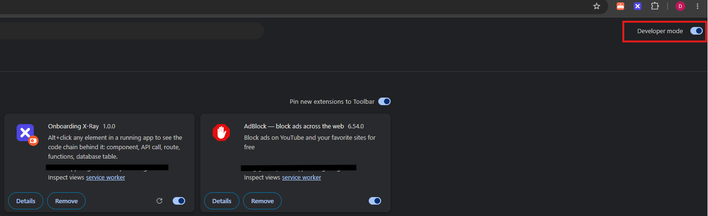

# Onboarding X-Ray
 
**Alt+click any element in a running web app and see every piece of code behind it, explained in plain English, on-device when possible.**
 
React component → API call → FastAPI route → Python functions → database table
 
[Live demo store](https://onboarding-xray.web.app) · [Download the extension](https://github.com/dhananjay1906/onboarding-xray/releases/latest) · [Demo video](YOUTUBE_LINK_HERE)
 

 
---
 
## Install in 60 seconds
 
You need Google Chrome. The extension is not in the Chrome Web Store; you install it from a GitHub Release.
 
1. **Download.** Open the [latest release](https://github.com/dhananjay1906/onboarding-xray/releases/latest) and, under **Assets**, click `onboarding-xray-submission-v1.0.0.zip`.
2. **Unzip.** Right-click the zip and choose **Extract All** (macOS: double-click it). Keep the extracted folder: Chrome loads the extension from it, so do not delete it. `manifest.json` must be directly inside that folder.
3. **Open the extensions page.** Type `chrome://extensions` in the address bar and press Enter.
4. **Turn on Developer mode.** Use the toggle in the top-right corner.
   
5. **Load the extension.** Click **Load unpacked** (top left) and select the folder from step 2.
   
6. **Take the tour.** The welcome page opens by itself. Follow step 2 there: it opens the live demo store and asks you to Alt+click **Place order** on the checkout page.

 
If the welcome page does not open, click the puzzle-piece icon in the Chrome toolbar, pin **Onboarding X-Ray**, and click its icon to open the side panel (the **?** button there replays the tour).
 
**Live demo:** https://onboarding-xray.web.app (the backend sleeps when idle, so the first load can take about a minute).
 
**On-device model (optional).** Explanations work in the cloud out of the box. For fully private, on-device explanations you need Chrome 139+ on a supported device; step 1 of the tour checks this and shows what to enable.
 
**Updating.** Download the new zip, unzip it over the old folder (or into a new one), then click the refresh icon on the extension's card at `chrome://extensions`. If you used a new folder, remove the old extension and load the new folder.
 
---
 
## The problem
 
A new developer on a team spends their first weeks asking one question over and over: *"When I click this button, what code actually runs?"* The answer is spread across a React component, an API client, a backend route, a service layer and database models. Existing tools answer only part of it:
 
- Click-to-source tools (LocatorJS, click-to-component) jump to **one frontend file**.
- Backend visualizers (Archy, fastapi-voyager) map the **backend only**, starting from code, not from the running app.
- Asking a cloud chatbot means **pasting private company code** into a third-party service.
## The solution
 
Onboarding X-Ray starts from the **live UI**. Alt+click a button and the side panel shows:
 
- **A flow diagram** of the full chain, one node per layer, across frontend and backend.
- **The real code** for every step, with file and line numbers.
- **A plain-English explanation** of each step and why it exists.
- **A badge on every explanation** showing where it was generated: 🔒 *On-device · private* or ☁️ *Cloud* (with the reason).
**Who it helps:** new hires, bootcamp grads joining their first team, open-source contributors, and the senior engineers who would otherwise spend hours walking them through the codebase.
 
## Hybrid AI with Firebase AI Logic
 
The core idea: **private code should stay on the developer's laptop whenever possible.**
 
| Mode (privacy toggle) | Inference mode | Behavior |
| --- | --- | --- |
| **Private only** | `InferenceMode.ONLY_ON_DEVICE` | Gemini Nano in Chrome only. No request ever leaves the machine. |
| **Auto** (default) | `InferenceMode.PREFER_ON_DEVICE` | On-device when the model is ready and the prompt fits; cloud otherwise. |
| **Best quality** | `InferenceMode.PREFER_IN_CLOUD` | Cloud model first. |
 
- **Per-step explanations** are short prompts (one code snippet each), which fit Gemini Nano, so they run on-device: private, free, and offline-capable.
- **"Summarize whole flow"** sends the full chain, which exceeds the on-device limit, so it goes to the cloud. The badge says *Cloud · too long for on-device*.
- If the model isn't downloaded yet, everything keeps working in the cloud while the tour's **Download on-device model** button fetches it.
**Where it's called in the code:**
- [`extension/src/lib/firebase.ts`](extension/src/lib/firebase.ts): Firebase app, App Check, Anonymous Auth, Firestore, Remote Config.
- [`extension/src/lib/explain.ts`](extension/src/lib/explain.ts): `getAI`, `getGenerativeModel(ai, { mode })`, on-device model initialization, and on-device/cloud source detection.
### Other Firebase products
 
| Product | How it's used |
| --- | --- |
| **App Check** | Required by Firebase AI Logic. The extension uses the App Check debug provider (reCAPTCHA can't run inside a Manifest V3 extension). |
| **Firestore** | Shared explanation cache, so a team doesn't regenerate the same answer. Keyed by a hash of prompt version, mode tier, layer and code. Graphs you load from your own project are never written to the shared cache. |
| **Anonymous Auth** | Gives each install an identity for Firestore rules, with no sign-in screen. |
| **Remote Config** | `on_device_max_chars`, `prompt_version`, `default_mode`, `cloud_model`: tune the on-device/cloud split without shipping a new build. |
| **Hosting** | Serves the live demo store at https://onboarding-xray.web.app. |
 
### How hallucination is limited
 
- The model only ever explains **code it is given**: each prompt contains the exact snippet for that step plus its role in the chain.
- The chain itself (which component calls which endpoint, which function touches which table) comes from **static analysis**, not from the model. The AI writes the words; it never decides the structure.
- Every explanation sits next to the real code, so it can be checked at a glance.
## How it works
 

 
1. **Analyzers (run once).** [`analyzer/backend_ast.py`](analyzer/backend_ast.py) uses Python's `ast` module to find FastAPI routes, follow calls two levels deep, and detect SQLModel tables. [`analyzer/frontend_calls.ts`](analyzer/frontend_calls.ts) uses Babel to find `fetch`/`axios` calls per React component. [`analyzer/merge_graph.py`](analyzer/merge_graph.py) joins them into `graph.json`, with code snippets embedded.
2. **Source tagging.** A Vite plugin adds `data-source="file:line"` to every JSX element, so a click knows which component it hit.
3. **Click overlay.** The extension's content script highlights elements while Alt is held; Alt+click sends the source location to the side panel.
4. **Side panel.** Looks up the chain in `graph.json`, draws it with React Flow, shows the code, and calls Firebase AI Logic for explanations.
There is **no X-Ray backend server**: the extension calls Firebase AI Logic directly from the browser.
 
## Use it on your own project
 
X-Ray explains **your** code, so it needs your source. It can't trace arbitrary websites, because a website never ships its backend code to the browser.
 
1. Run the analyzer:
```
npm run analyze -- --backend path/to/backend --frontend path/to/frontend --no-copy
```
2. Add the tagging plugin to your app's Vite config (see [`demo-app/frontend`](demo-app/frontend) for the example).
3. In the welcome tour, step 3: load your `graph.json` and click **Enable on this site** for your app's address. Chrome asks permission for that one site only.
**Supported today:** React + Vite frontends, FastAPI backends with SQLModel/SQLAlchemy, API calls via `fetch`/`axios` or a small wrapper.
**Future work:** Next.js, Django, Express and Spring analyzers; TypeScript backends; deeper call-graph tracing.
 
## Tech stack
 
| Area | Tools |
| --- | --- |
| Extension | Chrome Manifest V3, Vite, TypeScript, React, Tailwind CSS, React Flow |
| AI | Firebase AI Logic (hybrid inference), Gemini Nano in Chrome (on-device), Gemini Developer API (cloud) |
| Firebase | App Check, Firestore, Anonymous Auth, Remote Config, Hosting |
| Analyzers | Python `ast`, Node + `@babel/parser` |
| Demo app | React + Vite, FastAPI, SQLModel, SQLite; hosted on Firebase Hosting + Render |
 
## Developer setup
 
Requirements: Python 3.11+, Node.js 20+, Chrome 139+, a Firebase project with AI Logic (Gemini Developer API), App Check, Firestore and Anonymous Auth enabled.
 
```bash
# 1. Python environment
python -m venv .venv
# Windows: .venv\Scripts\Activate.ps1   macOS/Linux: source .venv/bin/activate
 
# 2. Demo app (two terminals) — see demo-app/README.md
pip install -r demo-app/backend/requirements.txt
cd demo-app/backend && python seed.py && uvicorn main:app --port 8000
cd demo-app/frontend && npm install && npm run dev
 
# 3. Analyze the demo app
npm run analyze
 
# 4. Extension
cp .env.example .env        # fill in VITE_FIREBASE_* values
cd extension && npm install && npm run build:dev
# chrome://extensions → Developer mode → Load unpacked → extension/dist
```
 
Register your App Check debug token in the Firebase console (App Check → Apps → ⋮ → Manage debug tokens). Details: [`extension/README.md`](extension/README.md).
 
**Tests:** analyzer tests (`analyzer/`), demo backend tests (`demo-app/backend/`), and extension unit tests (`cd extension && npm test`).
 
## My contribution
 
<!-- Write this section yourself — judges read it closely. Suggested points: -->
- **What I built:** _describe the idea, architecture decisions, and the parts you designed and debugged yourself._
- **What I learned:** _e.g. Python AST analysis, Chrome MV3 extensions, Firebase AI Logic hybrid inference, App Check in extensions._
- **Hardest problems:** _e.g. making App Check work inside an MV3 extension, getting the on-device model to download, matching frontend calls to backend routes._
## AI tools used
 
This project was built with help from AI coding assistants, as the hackathon rules allow:
- **Claude Code** (Anthropic): code generation, refactoring, tests and debugging, directed and reviewed by me.
- **Claude** (Anthropic): planning, research and documentation.
All design decisions, testing in Chrome and Firebase setup were done by me.
 
## Credits
 
- [Firebase JS SDK](https://github.com/firebase/firebase-js-sdk) and Firebase AI Logic (Google)
- Gemini Nano in Chrome and the Gemini Developer API (Google)
- [React Flow](https://reactflow.dev), [Babel](https://babeljs.io), [FastAPI](https://fastapi.tiangolo.com), [SQLModel](https://sqlmodel.tiangolo.com), [Tailwind CSS](https://tailwindcss.com), [Vite](https://vitejs.dev)
## License
 
[Apache License 2.0](LICENSE)
 