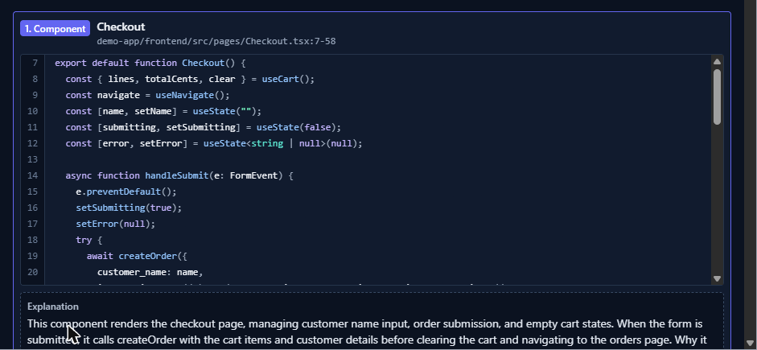
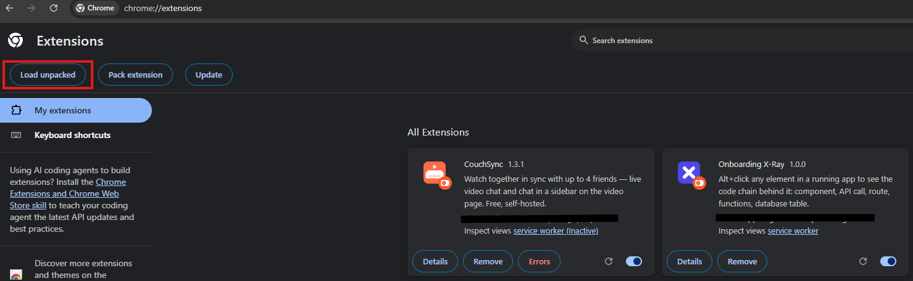
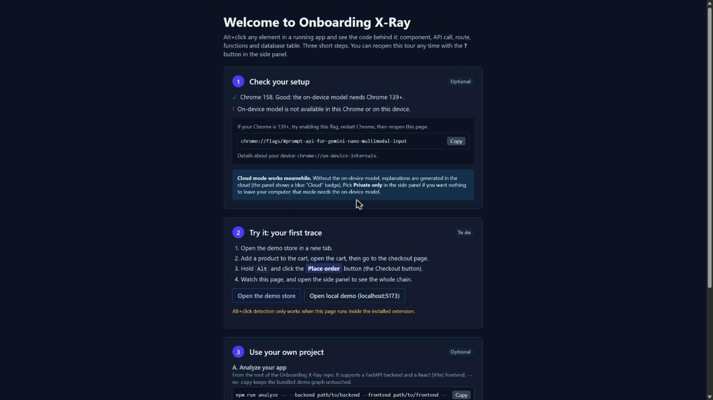

# Onboarding X-Ray
 
Hold Alt, click a button in a web app, and X-Ray shows you every piece of code that runs because of that click: the React component, the API call, the FastAPI route, the Python functions behind it and the database tables it touches. Each step comes with a short explanation in plain English, written on your own laptop by Gemini Nano whenever it can be.
 
**Try it:** [live demo store](https://onboarding-xray.web.app) · [download the extension](https://github.com/dhananjay1906/onboarding-xray/releases/latest) · [watch the demo](YOUTUBE_LINK_HERE)
 

 
## Why I built this
 
Every time I've joined a new codebase, the first few weeks go the same way. I see a button, I want to know what it does, and the answer is spread over five files in two languages. I end up grepping for route names, reading through service classes, and eventually asking someone senior to walk me through it.
 
There are tools for pieces of this. Some jump from a React element to its source file, and some draw a diagram of your backend. But nothing I found starts from the thing you're actually looking at, the running app, and follows the click all the way down to the database.
 
The other problem is privacy. The quick fix today is to paste company code into a chatbot, and a lot of teams simply aren't allowed to do that. So X-Ray tries to keep the code on the developer's machine and only goes to the cloud when it has to.
 
## Installing it
 
It isn't on the Chrome Web Store, so you load it yourself. It takes about a minute.
 
1. Grab `onboarding-xray-submission-v1.0.0.zip` from the [latest release](https://github.com/dhananjay1906/onboarding-xray/releases/latest).
2. Unzip it and keep the folder somewhere permanent. Chrome runs the extension from that folder, so don't delete it afterwards. You should see `manifest.json` directly inside it.
3. Open `chrome://extensions` and switch on **Developer mode** in the top-right corner.
   
4. Click **Load unpacked** and pick the unzipped folder.
   
5. A welcome tour opens. It checks your setup, then sends you to the demo store and asks you to Alt+click **Place order** on the checkout page. That's the best first click, because it travels through every layer.

 
If the tour doesn't open, pin X-Ray from the puzzle-piece menu and click its icon. The **?** button in the side panel brings the tour back.
 
A couple of things worth knowing:
- The demo store's backend is on a free host that goes to sleep, so the first page load after a quiet period can take close to a minute.
- Cloud explanations work straight away. On-device ones need Chrome 139 or newer on a machine that can run Gemini Nano. Step 1 of the tour checks this for you and can start the model download.
- To update, unzip the new release over the old folder and hit the refresh icon on the extension's card.
## Where the AI runs
 
Most of the interesting decisions in this project are about where each explanation gets written. There's a three-way switch at the top of the side panel:
 
- **Private only** uses Firebase AI Logic in `ONLY_ON_DEVICE` mode. Gemini Nano does all the work inside Chrome, and nothing leaves the machine. If the model isn't ready yet, X-Ray tells you so instead of quietly falling back.
- **Auto**, the default, uses `PREFER_ON_DEVICE`. Explanations of single steps are short enough for Nano, so in practice they stay local. Anything too long for the on-device model goes to Gemini in the cloud.
- **Best quality** uses `PREFER_IN_CLOUD`, for when you'd rather have the bigger model.
Every explanation carries a small badge saying where it came from: green for on-device, blue for cloud. The cloud badge also says why, for example "too long for on-device" or "model not downloaded". I wanted that to be visible rather than buried in a log, because if you're trusting a tool with your company's code you should be able to see what it's doing with it.
 
The "Summarize whole flow" button is the one place where cloud is the expected outcome. It sends the entire chain at once, which is more than Nano can take, so it escalates.
 
All the Firebase AI Logic code is in two files:
- [`extension/src/lib/explain.ts`](extension/src/lib/explain.ts) builds the prompts, creates the model with the chosen inference mode, starts the on-device model download, and works out which engine actually answered.
- [`extension/src/lib/firebase.ts`](extension/src/lib/firebase.ts) sets up the Firebase app, App Check, anonymous sign-in, Firestore and Remote Config.
### The rest of Firebase
 
App Check is required for AI Logic. Getting it to work in an extension was the most annoying part of the project: reCAPTCHA can't load inside a Manifest V3 extension, so X-Ray uses the App Check debug provider. The release build has a judging token baked in at build time, and it will be revoked after judging.
 
Firestore holds a shared cache of explanations, so a team doesn't pay to regenerate the same answer twice. Each entry is keyed on a hash of the prompt version, the mode, the layer and the code itself. If you load your own project's graph, those explanations stay out of the shared cache, since that code is yours. Anonymous Auth gives every install an identity for the Firestore rules without making anyone sign in.
 
Remote Config holds the numbers I kept wanting to tweak: the character limit for on-device prompts, the prompt version, the default mode and which cloud model to use. Firebase Hosting serves the demo store.
 
### Keeping the explanations honest
 
The model never decides what calls what. The chain of component to endpoint to function to table comes from static analysis of the source code. The model only gets one real snippet at a time and is asked to explain that snippet and why it exists. The code sits right next to the explanation in the panel, so if the model says something odd you can see it immediately.
 
## How it fits together
 
There are three parts, and no X-Ray server. The extension talks to Firebase directly.
 
**The analyzers** run once against a project. [`analyzer/backend_ast.py`](analyzer/backend_ast.py) walks the Python code with the standard `ast` module, finds FastAPI routes (including routers with prefixes), follows each handler's calls two levels down and notes which SQLModel tables get read or written. [`analyzer/frontend_calls.ts`](analyzer/frontend_calls.ts) parses the React code with Babel and finds the `fetch` and `axios` calls each component makes. [`analyzer/merge_graph.py`](analyzer/merge_graph.py) matches the two up by HTTP method and path, and writes a `graph.json` with the code snippets included.
 
**The demo store** is a small React + FastAPI shop with products, a cart, checkout and order history. Its Vite config includes a plugin that stamps every element with a `data-source="file:line"` attribute, which is how a click knows where it came from.
 
**The extension** has a content script that draws the highlight while you hold Alt and reports the click, a side panel that looks up the chain and draws it with React Flow, and the welcome tour.
 
To regenerate the demo graph after changing the store:
 
```
npm run analyze
```
 
## Using it on your own code
 
X-Ray needs your source, so it won't work on arbitrary websites. A site never sends its backend code to your browser, so there's nothing to trace. On your own project:
 
1. Run the analyzer against it:
```
npm run analyze -- --backend path/to/backend --frontend path/to/frontend --no-copy
```
2. Add the tagging plugin to your app's Vite config. The demo store's config in [`demo-app/frontend`](demo-app/frontend) shows how.
3. In step 3 of the welcome tour, load the `graph.json` you just made and click **Enable on this site**. Chrome asks permission for that one address and nothing else.
Right now this only understands React + Vite on the frontend and FastAPI with SQLModel or SQLAlchemy on the backend. I'd like to add Next.js, Django and Express next, but that's not done.
 
## Running it locally
 
You'll need Python 3.11+, Node 20+, Chrome 139+, and a Firebase project with AI Logic (Gemini Developer API), App Check, Firestore and Anonymous Auth turned on.
 
```bash
python -m venv .venv
# Windows: .venv\Scripts\Activate.ps1
# macOS/Linux: source .venv/bin/activate
 
# demo store, in two terminals
pip install -r demo-app/backend/requirements.txt
cd demo-app/backend && python seed.py && uvicorn main:app --port 8000
cd demo-app/frontend && npm install && npm run dev
 
# build the graph
npm run analyze
 
# the extension
cp .env.example .env          # add your VITE_FIREBASE_* values
cd extension && npm install && npm run build:dev
```
 
Then load `extension/dist` with **Load unpacked**. The side panel console prints an App Check debug token the first time it runs. Register it under App Check → Apps → ⋮ → Manage debug tokens. [`extension/README.md`](extension/README.md) covers the details, including how to build the release zip.
 
There are tests for the analyzers, the demo backend and the extension (`npm test` inside `extension/`).
 
## Built with
 
React, Vite, TypeScript, Tailwind and React Flow for the extension. Firebase AI Logic with Gemini Nano in Chrome and the Gemini Developer API. Firestore, App Check, Anonymous Auth, Remote Config and Hosting. Python's `ast` module and Babel for the analyzers. FastAPI, SQLModel and SQLite for the demo store, which is hosted on Firebase Hosting and Render.
 
## License
 
Apache 2.0, see [LICENSE](LICENSE).
 
